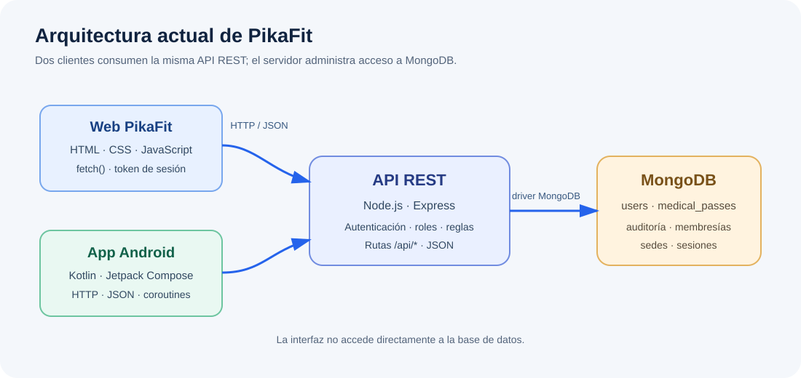
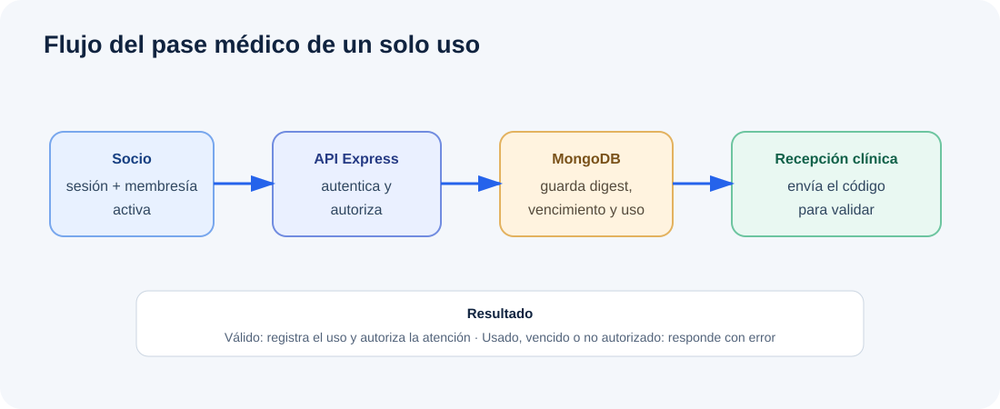

# Laboratorio 13 — Aplicaciones empresariales aplicadas a PikaFit

**Curso:** Desarrollo de Aplicaciones Empresariales  
**Sección:** C24T  
**Estudiante:** Jesus Castillo  
**Proyecto integrador:** [PikaFit](https://github.com/JesusCastillo2026/PikaFit-Proyecto-Integrador)

> Esta entrega aplica los ejercicios del laboratorio al proyecto integrador PikaFit, según la indicación del docente. El contenido anterior de cafetería se reemplaza por el análisis del proyecto real.

## Alcance y tecnología comprobada

La rama `main` del repositorio consultado describe PikaFit como una plataforma de membresías, entrenamiento y pases médicos, con web, aplicación Android y API REST. Su arquitectura actual es **Node.js + Express + MongoDB** para servidor y datos, **HTML/CSS/JavaScript** para la web y **Kotlin + Jetpack Compose** para Android. La web usa `fetch()` en `Web/app.js` y la app móvil usa `HttpURLConnection` desde `Android/.../Api.kt`.

El enunciado trae ejemplos con Django y React. Para que la entrega represente PikaFit sin inventar tecnologías, se documentan las equivalencias reales: módulos Express en `src/`, secciones web en `Web/`, pantallas Android en `Android/` y colecciones de MongoDB. No se presenta PikaFit como una aplicación Django o React.

## 1. Tipos de comercio y canales

| Tipo | Quién ofrece y quién recibe | Ejemplo aplicado |
|---|---|---|
| B2C | Una empresa ofrece un servicio a una persona. | PikaFit ofrece una membresía y funciones de entrenamiento al socio. |
| B2B | Una empresa ofrece servicios a otra organización. | PikaFit administra sedes, máquinas y accesos para gimnasios o clínicas afiliadas. |
| C2C | Una persona ofrece a otra persona mediante una plataforma. | Una persona publica y vende un artículo usado a otra en un marketplace peruano como Mercado Libre. |

PikaFit combina una relación **B2C** para sus socios y una relación **B2B** para la administración de sedes y clínicas afiliadas. Los canales web y Android se conectan con la misma API. M-commerce describe el uso del canal móvil; social commerce describe la interacción comercial desde redes sociales. No sustituyen la clasificación de quién vende a quién.

## 2. Módulos y roles

| Módulo | Función | Estado según el repositorio |
|---|---|---|
| Acceso y usuarios | Inicio de sesión, datos del perfil y roles. | Implementado en la API. |
| Membresías | Vigencia, bloqueo de acciones vencidas y avisos. | Implementado en API y panel. |
| Entrenamiento | Sedes, máquinas, rutinas, sesiones y seguimiento. | Implementado en módulos del servidor. |
| Pases médicos | Emisión de QR/código temporal y validación de un solo uso. | Implementado. |
| Gestión clínica | Evaluaciones, historial autorizado y reportes. | Implementado parcialmente por rol. |
| Administración y auditoría | Gestión de cuentas, permisos e historial de cambios. | Implementado. |
| Android | Acceso a funciones móviles mediante la API. | Aplicación nativa Kotlin. |

| Rol | Acciones principales |
|---|---|
| `SOCIO` | Consultar membresía, entrenar y generar un pase si está activo. |
| `COACH` | Consultar miembros asignados y seguimiento. |
| `ADMIN_B2B` | Gestionar sedes, máquinas y material de ejercicios. |
| `ADMIN` | Administrar usuarios, roles y configuración. |
| `MEDICO` | Registrar evaluaciones y consultar historiales autorizados. |
| `RECEPCION_CLINICA` | Validar el pase médico de un socio en su clínica. |
| `ADMIN_CLINICA` | Consultar historial de pases, membresías y reportes de su clínica. |
| `AUDITOR` | Revisar eventos de auditoría permitidos. |

## 3. Requisitos funcionales y no funcionales

Un requisito funcional describe una acción que realiza el sistema. Uno no funcional especifica una cualidad o restricción que debe verificarse.

| ID | Tipo | Requisito | Prioridad | Criterio de aceptación |
|---|---|---|---|---|
| RF-01 | Funcional | Iniciar sesión con correo o DNI y contraseña. | Alta | Credenciales válidas devuelven token y perfil; inválidas reciben error sin revelar si existe la cuenta. |
| RF-02 | Funcional | Mostrar el panel según el rol autenticado. | Alta | Cada rol ve únicamente sus módulos habilitados. |
| RF-03 | Funcional | Emitir un pase médico temporal a un socio con membresía activa. | Alta | La API devuelve código/QR y vencimiento; un socio vencido no puede emitirlo. |
| RF-04 | Funcional | Validar el pase en recepción y evitar su reutilización. | Alta | El primer uso autorizado queda registrado; un segundo intento se rechaza. |
| RF-05 | Funcional | Permitir que la administración clínica consulte actividad y reporte mensual. | Media | La respuesta incluye solo información de la clínica asociada y permite descarga CSV. |
| RNF-01 | No funcional | Proteger rutas privadas con token y autorización por rol. | Alta | Las pruebas verifican que la petición sin sesión recibe 401 y el rol no autorizado recibe 403. |
| RNF-02 | No funcional | No almacenar contraseñas en texto plano. | Alta | La base solo contiene un hash y el inicio de sesión valida contra él. |
| RNF-03 | No funcional | Restringir los datos clínicos a personal autorizado de la clínica. | Alta | Un médico sin `clinicId` no accede al historial y la API responde 403. |
| RNF-04 | No funcional | Evitar aceptar JSON de tamaño ilimitado. | Media | El servidor aplica límite de cuerpo de 32 KB y maneja JSON mal formado con respuesta 400. |
| RNF-05 | No funcional | Mantener navegación utilizable en web y móvil. | Media | Las acciones principales son accesibles con teclado y los paneles responden a tamaños de pantalla usados en la verificación. |

## 4. Arquitectura y flujo principal



**Flujo de emisión y validación del pase:** el socio inicia sesión; la web o Android envía la petición autenticada a Express; el servidor comprueba rol y membresía; crea un pase de un solo uso en MongoDB; devuelve código/QR y vencimiento; recepción envía el código; la API valida clínica, vigencia y estado; MongoDB registra el uso; la interfaz presenta el resultado.



La API recibe y devuelve JSON por HTTP. El servidor aplica las reglas y consulta MongoDB. Las credenciales de tarjeta no forman parte de este flujo ni deben guardarse en PikaFit. Si se añade un proveedor de pagos, la pasarela debe recibir los datos de pago y PikaFit conservar solo identificadores y estados necesarios.

## 5. Reglas de negocio y errores que previenen

| Regla | Dónde se aplica | Error que evita |
|---|---|---|
| Solo una membresía activa permite emitir un pase. | API: middleware/regla de membresía; la interfaz refleja el estado. | Emitir un pase para un usuario vencido. |
| El pase vence y solo puede validarse una vez. | API y colección `medical_passes`. | Reutilizar un QR/código antiguo o duplicar una atención. |
| Cada ruta exige rol y, en clínica, una `clinicId` asociada. | Middleware y controlador Express. | Acceso de una clínica a datos de otra o privilegios indebidos. |
| La contraseña se almacena como hash; los tokens y secretos no van al cliente. | Servicio de autenticación y configuración del servidor. | Exposición de credenciales y suplantación por lectura directa de la base. |
| La API determina permisos y datos válidos; ocultar botones en la web no es seguridad. | Servidor Express. | Que un usuario invoque directamente una ruta restringida. |

## 6. Estructura del backend

En PikaFit, la carpeta `src/` cumple el papel de módulos de negocio. La configuración del servidor y sus dependencias están registradas en el proyecto Node, no en `INSTALLED_APPS` de Django.

```text
PikaFit-Proyecto-Integrador/
├── src/
│   ├── server.js              # API REST y montaje de rutas
│   ├── auth.js                # autenticación, roles y membresía
│   ├── users.js               # usuarios y perfiles públicos
│   ├── passes.js              # emisión y validación de pases
│   ├── clinic-reports.js      # reportes de clínica
│   ├── training.js            # sedes, máquinas y funciones clínicas
│   ├── workouts.js            # rutinas y sesiones
│   ├── sprint3.js             # funciones adicionales de entrenamiento
│   ├── db.js                  # conexión e índices de MongoDB
│   └── http.js                # errores y validación HTTP
├── Web/                       # interfaz HTML, CSS y JavaScript
├── Android/                   # cliente Kotlin / Jetpack Compose
├── MongoDB Compass/           # referencia de colecciones e índices
├── scripts/                   # tareas administrativas
└── tests/                     # pruebas automatizadas
```

En Django, un **proyecto** contiene configuración general y una **app** agrupa una capacidad. En PikaFit, el equivalente organizativo son el arranque del servidor en `src/server.js` y los módulos separados por dominio; no se crean apps Django ajenas al proyecto.

## 7. Estructura de la interfaz y clientes

La interfaz web existente es una página con secciones por rol. `Web/app.js` centraliza las peticiones en una función `api(path, options)`, añade el token de sesión y convierte errores HTTP en mensajes de interfaz. Android implementa su cliente en `Android/app/src/main/java/com/pikafit/mobile/Api.kt` y ejecuta solicitudes de red en `Dispatchers.IO`.

```text
Web/
├── index.html       # formularios y paneles
├── app.js           # sesión, renderizado y llamadas fetch a /api
└── styles.css       # estilos

Android/app/src/main/java/com/pikafit/mobile/
├── MainActivity.kt  # pantallas Compose
├── Api.kt           # cliente HTTP y modelos de respuesta
└── SessionStore.kt  # sesión local protegida
```

El enunciado propone `components/`, `pages/` y Axios para un cliente React. PikaFit no usa esa estructura en su web actual; sus equivalentes son las secciones DOM y módulos de `Web/app.js`, con `fetch`. No se añaden archivos React vacíos porque no representarían una función real.

## 8. Mapa de rutas

| Recurso / operación | Método y ruta API | Interfaz que la utiliza |
|---|---|---|
| Estado del servicio | `GET /api/health` | verificación de servidor |
| Inicio de sesión | `POST /api/auth/login` | formulario de acceso web y Android |
| Perfil autenticado | `GET /api/me` | panel correspondiente al rol |
| Notificaciones del socio | `GET /api/me/notifications` | panel del socio |
| Emitir pase médico | `POST /api/medical-passes` | panel del socio y aplicación Android |
| Validar pase en clínica | `POST /api/clinic/passes/validate` | pantalla de recepción |
| Historial de pases | `GET /api/clinic/passes/history` | administración de clínica |
| Membresías próximas a vencer | `GET /api/clinic/memberships/expiring` | administración de clínica |
| Reporte mensual | `GET /api/clinic/reports/monthly` | administración de clínica |
| Descargar reporte | `GET /api/clinic/reports/monthly.csv` | botón CSV de administración |
| Sedes | `GET/POST /api/sites` | administración B2B |
| Máquinas de una sede | `GET/POST /api/sites/:siteId/machines` | administración B2B y socio (lectura permitida) |

La web es una aplicación de una sola página servida desde `Web/index.html`; por ello, la columna de interfaz nombra la sección o pantalla, no una ruta React inexistente.

## 9. Entidad principal y módulos del proyecto

La operación principal de este laboratorio es emitir y validar un pase médico. La entidad principal es `medical_passes`; sus registros se relacionan con `users` (socio) y con la clínica/recepción que valida. Las colecciones adicionales documentadas son `role_audit`, `membership_notifications`, `medical_evaluations`, `sites`, `machines`, `exercises`, `routines` y `workout_sessions`.

## 10. Requisitos y reglas aplicados a PikaFit

Las tablas de los ejercicios 3 y 5 constituyen los requisitos verificables y reglas del proyecto. El criterio central es que la autorización se realiza en el servidor, con rol y pertenencia a clínica; la interfaz solo presenta acciones permitidas.

## 11. Arquitectura, flujo y entidades

La arquitectura y el flujo se ilustran en los diagramas anteriores. Para este alcance se consideran las entidades `users`, `medical_passes`, `role_audit`, `membership_notifications`, `medical_evaluations`, `sites`, `machines`, `routines` y `workout_sessions`. `medical_passes` representa el pase; `role_audit` e historial de validación conservan eventos relacionados.

## 12. Aplicaciones y módulos

PikaFit conserva un único servidor Express y organiza el dominio en módulos independientes (`auth.js`, `users.js`, `passes.js`, `training.js`, `workouts.js`, `clinic-reports.js`). MongoDB crea colecciones e índices al conectar, mediante `src/db.js`. Esta organización se mantiene en lugar de registrar apps Django que el proyecto real no usa.

## 13. Estructura de carpetas y mapa de rutas

El árbol real está documentado en los ejercicios 6 y 7; el mapa API/interfaz está en el ejercicio 8. Las fuentes se pueden contrastar en el [repositorio de PikaFit](https://github.com/JesusCastillo2026/PikaFit-Proyecto-Integrador), particularmente `src/server.js`, `src/db.js`, `Web/app.js` y `Android/.../Api.kt`.

## 14. Verificación y publicación

Comandos documentados por el proyecto:

```powershell
npm ci
Copy-Item .env.example .env
# Completar .env local sin compartir secretos
npm test
npm start
```

Con MongoDB ejecutándose, `npm start` conecta la API y sirve la web. El informe contiene diagramas basados en la estructura y las rutas del repositorio, junto con fragmentos de código citados. No se presentan resultados de ejecución local: este paquete documenta el diseño y el código fuente, no una prueba ejecutada en esta sesión.

El informe se entrega como [`Semana 13.pdf`](../Documentos%201-16/Semana%2013.pdf).

## Referencias verificables

- [README y estructura de PikaFit](https://github.com/JesusCastillo2026/PikaFit-Proyecto-Integrador)
- [Rutas de la API — `src/server.js`](https://github.com/JesusCastillo2026/PikaFit-Proyecto-Integrador/blob/main/src/server.js)
- [Conexión e índices — `src/db.js`](https://github.com/JesusCastillo2026/PikaFit-Proyecto-Integrador/blob/main/src/db.js)
- [Cliente web — `Web/app.js`](https://github.com/JesusCastillo2026/PikaFit-Proyecto-Integrador/blob/main/Web/app.js)
- [Cliente Android — `Api.kt`](https://github.com/JesusCastillo2026/PikaFit-Proyecto-Integrador/blob/main/Android/app/src/main/java/com/pikafit/mobile/Api.kt)

