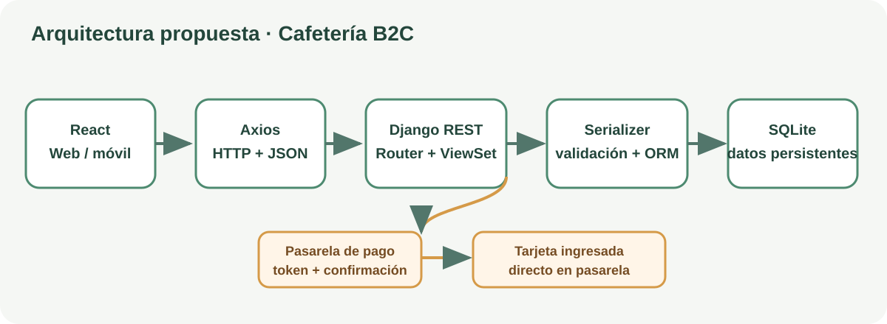
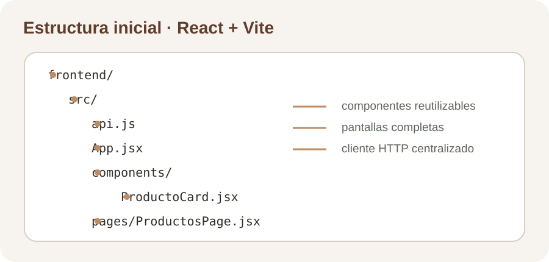
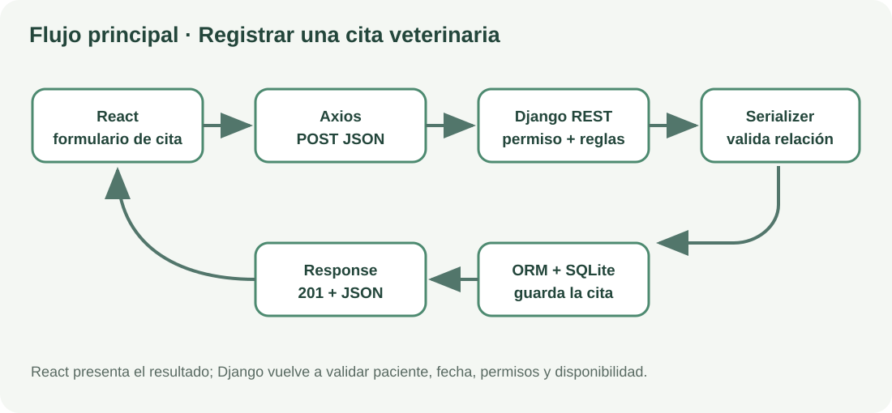

# Semana 13 — Aplicaciones de comercio electrónico

Laboratorio de diseño y estructura inicial. La primera parte crea la base de una cafetería en línea; la segunda adapta los requisitos del ejercicio al proyecto clínico construido en las Semanas 8–12 de este repositorio.

## Carpetas

- `practica/backend/`: proyecto Django base con las apps `catalogo` y `pedidos`.
- `practica/frontend/`: base React + Vite con `components`, `pages` y Axios.
- `integrador/`: análisis de requisitos, módulos, reglas y rutas de la clínica veterinaria del curso. El backend y el panel funcional se conservan en [Semana 12](../Semana_12/).

## Ejecución de la práctica (cafetería)

Terminal 1:

```powershell
cd Semana_13/practica/backend
python -m venv .venv
.\.venv\Scripts\Activate.ps1
pip install -r requirements.txt
python manage.py check
python manage.py runserver
```

Terminal 2:

```powershell
cd Semana_13/practica/frontend
npm install
npm run dev
```

Para verificar compilación y reglas de estilo, desde `frontend` ejecuta `npm run lint` y `npm run build`. El endpoint de productos es parte del diseño que se implementará junto con los modelos en Semana 14; esta semana establece estructura, requisitos y mapa de rutas.

## Entregables documentados

Las respuestas a los ejercicios 1–14, tablas de requisitos/roles/reglas/rutas y diagramas de arquitectura y flujo están en este README. Las imágenes vectoriales también están disponibles en [evidencias](evidencias/). El PDF `../Documentos 1-16/Semana 13.pdf` desarrolla el procedimiento con mayor detalle.

> Evidencia: los SVG incluidos son diagramas de diseño elaborados para este laboratorio. No son capturas de terminal ni simulan resultados de ejecución. Las salidas de `python manage.py check`, `npm run lint` y `npm run build` deben capturarse al ejecutar el proyecto en el equipo.

## Parte 1 — Cafetería en línea

### Ejercicio 1. Tipo de comercio y canales

| Tipo | Quién vende a quién | Ejemplo peruano |
|---|---|---|
| B2C | Empresa a consumidor final | Tottus vende productos directamente a personas mediante su tienda en línea. |
| B2B | Empresa a empresa | Makro vende productos al por mayor a negocios y compradores institucionales. |
| C2C | Persona a persona, mediante una plataforma | Mercado Libre permite publicaciones de vendedores particulares para compradores particulares. |

La cafetería en línea es **B2C**: la cafetería ofrece productos al consumidor. Puede usar web, aplicación móvil y redes sociales conectadas a una misma API. *M-commerce* indica que la compra ocurre desde un dispositivo móvil; *social commerce* indica que el descubrimiento o compra se realiza dentro o desde una red social. Ambos describen canales de interacción y venta, mientras B2C/B2B/C2C identifican quién participa en la transacción.

### Ejercicio 2. Módulos y roles

| Módulo | Alcance | Semana prevista |
|---|---|---:|
| Catálogo e inventario | Productos, precio vigente, disponibilidad y categorías | 14 |
| Carrito | Selección temporal y cantidades antes de confirmar | 15 |
| Clientes y acceso | Perfil, sesión y permisos por rol | 15 |
| Pedidos | Confirmación, detalle y estados del pedido | 14–15 |
| Pagos | Inicio y confirmación mediante proveedor externo | 16 |
| Administración | Productos, stock, pedidos y reportes | 15 |
| Seguridad y notificaciones | Validaciones, autorización y avisos de estado | 16 |

| Rol | Puede hacer | Pantalla principal |
|---|---|---|
| Visitante | Consultar y buscar productos; armar un carrito local | Catálogo |
| Cliente | Confirmar pedido, consultar estado e historial | Catálogo, carrito y mis pedidos |
| Administrador | Gestionar catálogo, inventario y pedidos | Panel administrativo |

### Ejercicio 3. Requisitos de la cafetería

**Requisito funcional** define una acción o respuesta del sistema; **no funcional** establece una cualidad medible o una restricción de calidad.

| ID | Tipo | Descripción | Prioridad | Criterio de aceptación |
|---|---|---|---|---|
| RF-01 | Funcional | Mostrar el catálogo con nombre, descripción, precio y disponibilidad. | Alta | La página presenta los campos de cada producto activo recibido por la API. |
| RF-02 | Funcional | Buscar productos por nombre y categoría. | Media | Una búsqueda devuelve coincidencias y un mensaje claro cuando no las hay. |
| RF-03 | Funcional | Añadir y quitar productos del carrito y cambiar cantidades. | Alta | El subtotal se recalcula y ninguna cantidad queda por debajo de 1. |
| RF-04 | Funcional | Confirmar un pedido con datos de entrega y resumen de compra. | Alta | Al confirmar, la API crea un pedido con detalle, total y estado inicial. |
| RF-05 | Funcional | Permitir al administrador cambiar disponibilidad y revisar pedidos. | Alta | Solo el rol administrador puede guardar cambios en inventario o pedido. |
| RNF-01 | No funcional | Responder al catálogo dentro del umbral acordado. | Media | En pruebas de carga, el percentil 95 de GET catálogo es menor a 2 s con 100 sesiones concurrentes. |
| RNF-02 | No funcional | Proteger el tráfico fuera del entorno local. | Alta | El despliegue productivo redirige HTTP a HTTPS y no expone secretos en el cliente. |
| RNF-03 | No funcional | Aplicar control de acceso en operaciones administrativas. | Alta | Las pruebas verifican que visitante y cliente reciben 403 al invocar cambios administrativos. |
| RNF-04 | No funcional | Mantener el catálogo utilizable en móvil y escritorio. | Media | A 360 px y 1280 px no hay desplazamiento horizontal y las acciones principales siguen visibles. |
| RNF-05 | No funcional | Mantener precisión monetaria. | Alta | El total calculado por servidor coincide con la suma decimal de las líneas del pedido a 2 decimales. |

“Rápido y seguro” es vago: no ofrece medida ni prueba. Se reescribe como: **(1)** “El endpoint de catálogo debe completar el 95 % de GET en menos de 2 s con 100 sesiones concurrentes en el entorno de pruebas”; **(2)** “En producción todo tráfico se sirve por HTTPS y las rutas administrativas rechazan solicitudes sin rol autorizado con 403”.

### Ejercicio 4. Arquitectura y flujo de compra



React envía HTTP/JSON con Axios a Django REST Framework. El Router conduce a un ViewSet; el serializer valida y convierte datos, el ORM consulta SQLite y la respuesta vuelve con JSON y un código HTTP. En pago, Django crea una sesión en la pasarela y recibe un identificador/token y confirmación; el PAN y CVV se ingresan directamente en la pasarela, no se envían al sistema de la cafetería.

| Paso de compra | React | Django / estado |
|---:|---|---|
| 1 | Consulta y muestra productos. | API devuelve catálogo disponible; no hay pedido. |
| 2 | Cliente elige cantidades en el carrito. | El carrito sigue temporal en la interfaz; stock aún no se descuenta. |
| 3 | Cliente ingresa contacto y entrega. | API valida formato, identidad y productos solicitados. |
| 4 | Cliente confirma el resumen. | Servidor vuelve a leer precios y stock vigentes; crea pedido pendiente. |
| 5 | React inicia pago y redirige/abre pasarela. | Django genera la sesión de pago con total e identificador del pedido. |
| 6 | Pasarela recibe los datos de pago. | Django recibe token/resultado firmado, no los datos de tarjeta. |
| 7 | React consulta confirmación y muestra el resultado. | Servidor verifica confirmación, marca pagado y reserva/actualiza stock. |
| 8 | Cliente ve el seguimiento. | Pedido avanza a preparación, listo y entregado; cancelaciones liberan stock según regla. |

### Ejercicio 5. Reglas de negocio y errores que evitan

| Regla | Dónde se aplica | Error que evita |
|---|---|---|
| El precio definitivo se lee desde la base de datos al crear el pedido; no se confía en el valor enviado por React. | Django; React solo muestra una referencia. | Manipulación del total desde DevTools o una petición alterada. |
| El servidor vuelve a comprobar stock y reserva unidades de forma atómica al confirmar el pedido. | Django/BD; React comunica disponibilidad. | Sobreventa por dos compras simultáneas o un cliente con una pantalla antigua. |
| Los importes usan `Decimal` en servidor y campo decimal en BD; nunca `float` para dinero. | Django/BD. | Errores de redondeo acumulados en subtotales y total. |
| La tarjeta se procesa en una pasarela certificada; la aplicación almacena solo referencia/token y resultado. | Pasarela y backend seguro. | Exposición de PAN/CVV y almacenamiento de datos de pago sensibles. |
| El carrito es temporal y editable; el pedido es un registro confirmado, persistente y con estados. | React para carrito; Django para pedido. | Confundir una intención no confirmada con una compra realizada. |

No basta controlar stock en React: el navegador está bajo control del usuario, puede tener datos desactualizados y dos compradores pueden confirmar a la vez. La regla autoritativa y la actualización atómica deben ocurrir en el servidor/base de datos.

### Ejercicio 6. Apps Django

La práctica incluye las apps iniciales `catalogo` y `pedidos`, registradas en `INSTALLED_APPS`. El proyecto es la configuración global (`core/settings.py`, URL raíz y ASGI/WSGI); una aplicación agrupa una responsabilidad reutilizable del negocio (por ejemplo, catálogo). El scaffold no crea modelos ni API de tienda porque la guía reserva su implementación para Semana 14.

### Ejercicio 7. Estructura React



`components/` contiene piezas reutilizables de interfaz, como `ProductoCard.jsx`; `pages/` agrupa pantallas completas, como `ProductosPage.jsx`; `api.js` centraliza el Axios base. La estructura creada conserva la integración de productos para la semana de API/modelos.

### Ejercicio 8. Mapa de rutas y diferencias

| Recurso / pantalla | Ruta Django propuesta | Ruta React propuesta |
|---|---|---|
| Catálogo y productos | `GET /api/productos/` | `/productos` |
| Detalle de producto | `GET /api/productos/{id}/` | `/productos/{id}` |
| Carrito | `POST /api/carrito/items/` | `/carrito` |
| Confirmar pedido | `POST /api/pedidos/` | `/checkout` |
| Pedidos del cliente | `GET /api/pedidos/mios/` | `/mis-pedidos` |
| Administración de productos | `POST/PATCH /api/productos/` | `/admin/productos` |

La ruta de API identifica un recurso HTTP del servidor y responde JSON/códigos HTTP. La ruta de React selecciona una pantalla del cliente; no crea ni modifica datos por sí sola. La ruta de API del catálogo es una propuesta para Semana 14, no una función declarada como terminada en este scaffold.

## Parte 2 — Proyecto integrador del curso: clínica veterinaria

La equivalencia se realiza con la aplicación de clínica veterinaria ya construida en las semanas anteriores de este repositorio. El backend Django y panel React ejecutables están en Semana 12; este laboratorio documenta su diseño y la estructura incremental sin duplicar modelos ni alterar las entregas anteriores.

### Ejercicio 9. Entidad, módulos y rutas

| Concepto | Equivalencia en el proyecto |
|---|---|
| Tipo y canales | Servicio B2C de clínica veterinaria; panel web actual y posibilidad futura de canal móvil consumiendo la misma API. |
| Entidad principal | Cita veterinaria; detalle/relación: paciente, propietario, motivo y fecha. |
| Módulos | Pacientes y propietarios (implementados), citas, servicios, historiales, medicamentos, reportes y administración. |
| Roles | Administrador (gestiona catálogos y accesos), personal clínico (gestiona citas y fichas), propietario (consulta sus datos y citas; autenticación todavía pendiente). |
| Reglas | Peso del paciente > 0 (serializer/API); una cita debe referir a un paciente existente y fecha válida (validación de servidor por completar). |
| Rutas API / React | `/api/pacientes/` → `/pacientes`; `/api/propietarios/` → `/propietarios`; `/api/citas/` → `/citas`; `/api/servicios/` → `/servicios`. |

### Ejercicio 10. Requisitos, módulos y reglas

La clínica comparte el mapa de módulos de Semana 12. En el proyecto vigente ya existen pacientes, propietarios, citas, historiales, servicios, medicamentos y sus serializadores/endpoints. El panel permite buscar y hacer CRUD de pacientes. Autenticación con roles, vistas de citas y permisos por propietario son trabajo por implementar; no se presentan como funciones terminadas.

| ID | Requisito de la clínica | Prioridad | Criterio de aceptación |
|---|---|---|---|
| CF-01 | Buscar pacientes por nombre, especie o propietario. | Alta | La respuesta del filtro contiene solo coincidencias del parámetro `search`. |
| CF-02 | Registrar un paciente vinculado a un propietario existente. | Alta | La API devuelve 201 y el nuevo paciente aparece en el listado. |
| CF-03 | Actualizar y eliminar paciente. | Alta | PATCH devuelve 200; DELETE devuelve 204 y retira la fila. |
| CF-04 | Registrar una cita asociada a un paciente. | Alta | La cita guarda paciente, fecha/hora y motivo; un paciente inexistente se rechaza. |
| CF-05 | Consultar servicios e historial clínico autorizado. | Media | El personal obtiene datos del paciente seleccionado; un usuario sin permiso recibe 403. |
| CNF-01 | Restringir acceso por rol y relación con la clínica. | Alta | Pruebas de autorización cubren las rutas y el 100 % de los roles definidos. |
| CNF-02 | Responder búsqueda/listado dentro del umbral. | Media | El percentil 95 de consultas de prueba es menor a 2 s con 100 usuarios concurrentes. |
| CNF-03 | Mantener el panel usable en escritorio y móvil. | Media | En ancho 360 px no hay desbordamiento horizontal ni controles inaccesibles. |

| Regla de negocio | Aplicación prevista |
|---|---|
| El peso del paciente debe ser mayor que cero. | Django serializer; también hay validación de ayuda en React. |
| Toda cita debe tener paciente existente y fecha futura/formato válido. | Django API y base de datos. |
| El propietario de una ficha solo puede consultar pacientes asociados a su cuenta. | Autorización del servidor; nunca solo filtro React. |
| Una cita cancelada no ocupa una franja disponible. | Servicio de citas en Django al cambiar estado. |
| Toda modificación clínica conserva responsable y momento de auditoría. | Backend; permiso de lectura/escritura según rol. |

### Ejercicio 11. Arquitectura, flujo y entidades



Flujo principal: React consulta pacientes/citas; el usuario registra una cita; Django valida sesión, permiso, paciente y horario; el ORM guarda la cita; la API devuelve JSON y estado; React actualiza la pantalla. Entidades previstas o existentes: **Propietario, Paciente, Cita, Servicio, PacienteServicio, HistorialMedico, Medicamento y Veterinario**. Cita es la entidad principal de la operación; sus relaciones vinculan paciente, y paciente vincula propietario.

### Ejercicio 12. Apps y core Django

El proyecto de clínica ya conserva `core` como configuración y la app `gestion_clinica` registrada, con los modelos y rutas trabajados previamente. Para no dividir modelos existentes ni crear copias conflictivas, esta entrega documenta la estructura vigente y la reutiliza desde [Semana 12](../Semana_12/backend/). La cafetería sí incluye las apps iniciales independientes `catalogo` y `pedidos`, como solicita el ejercicio de estructura.

### Ejercicio 13. Componentes, páginas y mapa de rutas

El panel existente usa `frontend/src/components` y `frontend/src/api.js`. Se agrega `frontend/src/pages` con los espacios iniciales para las pantallas de pacientes, citas y servicios. La tabla de rutas del ejercicio 9 relaciona cada recurso API con su vista; la guía de la práctica también deja las rutas de cafetería documentadas.

### Ejercicio 14. Verificación y publicación

Las instrucciones reproducibles son `python manage.py check` para el proyecto de cafetería, `npm run lint` y `npm run build` para cada frontend. No afirmo una salida exitosa de comandos que no se ejecutaron en esta sesión. El repositorio excluye `node_modules`, `dist`, entornos virtuales y base SQLite local. El diseño, módulos, reglas, arquitectura, carpetas y rutas quedan documentados aquí y en el [README general](../README.md).

## Fuentes del proyecto y alcance

El proyecto base de clínica usado para la Parte 2 es [Semana 12](../Semana_12/), mientras que la cafetería es un scaffold estructural para Semana 14. No se implementa pago real, autenticación de tienda, modelos ni CRUD del catálogo en la Semana 13; esta etapa deja definiciones y estructura listas para avanzar.
